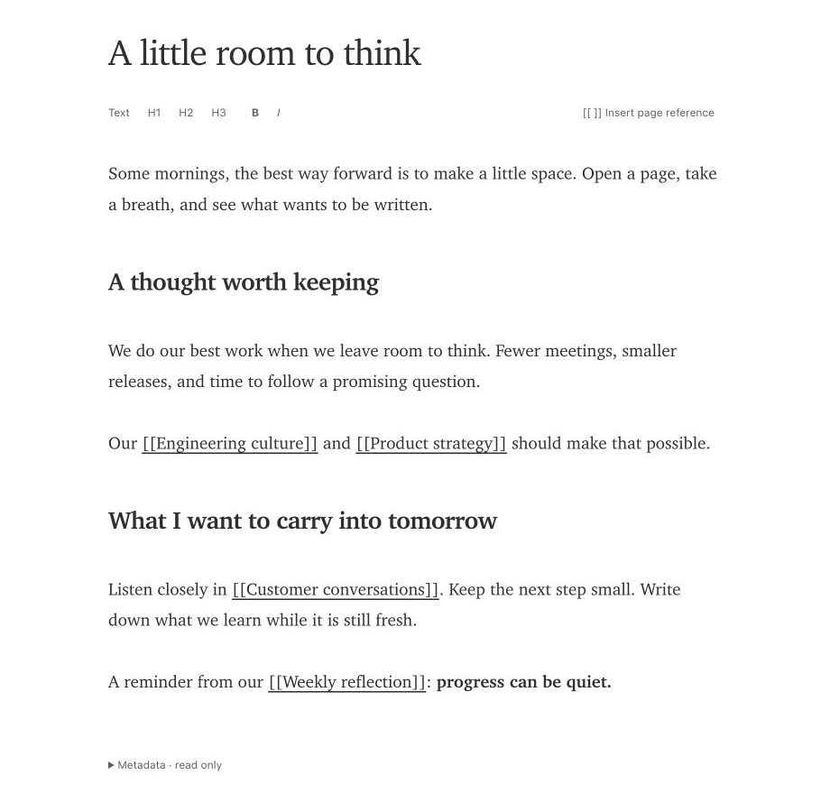
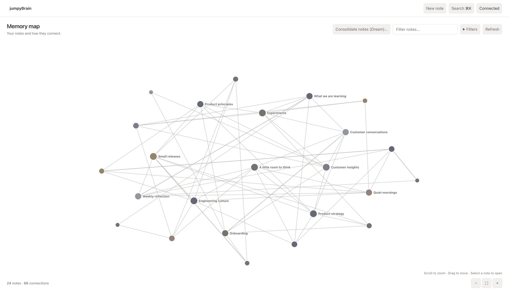

<p align="center">
  
</p>

<h1 align="center">Good thoughts deserve a home.</h1>

<p align="center">
  <strong>The open-source, agent-first Notion.</strong><br />
  A beautiful Markdown workspace where you, your team, and your AI agents think together.<br />
  Start with a local brain. Add shared brains when you're ready. Make it your own.
</p>

<p align="center">
  <strong><a href="https://demojumpybrain.juttu.co/">Explore the demo</a></strong>
  ·
  <a href="#start-your-own-brain">Start your own brain</a>
  ·
  <a href="docs/cloud-shared-memory.md">Bring your team</a>
</p>

<p align="center">
  MIT licensed · Markdown you own · Local and self-hosted · Beta
</p>

## Your best thinking shouldn't disappear into a chat

You work something out with an agent. Make a decision with your team. Write down an idea worth keeping. Then a new chat starts, someone needs the backstory, or you switch tools—and you're explaining it all again.

jumpyBrain gives that knowledge a home. A calm place to write, connected notes to explore, and memory your agents can search and build on alongside you. Your notes, decisions, and discoveries stay useful beyond the conversation that created them.

It's for people who think with agents, builders who switch between tools, and teams who want their knowledge to outlast a handoff.

## A beautiful place to think

Open a note and start writing. Format as you go, connect ideas with `[[page references]]`, and let your changes save automatically to Markdown. A quiet editor, light and dark themes, and room for a thought to develop.

<p align="center">
  <a href="docs/assets/jumpybrain-writing.webp">
    
  </a>
</p>

Your agent works with the same notes. Ask it to capture a decision, find the reasoning behind an old choice, or help turn scattered research into something you can use. The editor reflects external note updates, so you can work alongside your agent.

## Start with your brain. Grow into a shared one.

**Just you.** Choose a folder and keep your thoughts on your own machine. Write in jumpyBrain or open the Markdown in another editor. Local use needs no account or subscription.

**You and your agents.** Claude Code, Codex, Pi, and other CLI-capable agents can remember and recall from the same brain. Switch tools or start a fresh session with your knowledge still available.

**You and your team.** Self-host a shared brain and connect to it from the editor and CLI. Keep personal notes local while your team's decisions, research, and handoffs have a shared home. A decision captured by one teammate becomes discoverable by another teammate's agent.

On macOS, add named local and remote brains in Settings and switch between them. A remote connection edits the shared brain on its server; personal brains stay separate. [Set up a shared brain →](docs/cloud-shared-memory.md)

## Give your agent the context it needs

Agent memory should help with the task at hand. jumpyBrain is built around finding relevant evidence, keeping context focused, and opening more detail when it's needed.

- **Search for meaning and exact details.** Search titles and text out of the box. Add a local embedding model for semantic retrieval when you want to find related ideas beyond the words you remember.
- **Choose how much to recall.** Shallow recall favors condensed pages and decisions. Deep recall can surface the original conversations and source evidence.
- **Follow an answer back to its source.** Results include file and line references. Agents can request a bounded source section when an excerpt needs more context.
- **Keep context deliberate.** Recall is explicit by default. Compact output offers a size cap, and agents can expand evidence as needed instead of loading the whole brain into every prompt.
- **Keep history in view.** Date filters and chronological results help agents investigate what was recorded at different times, with sources available to check what changed.

The goal is useful answers with less context and less waiting. We optimize for answer quality, total retrieved tokens, and latency; comparative speed and token savings against Notion MCP still need reproducible benchmarks. See the [retrieval design](docs/technical.md) and [agent workflows](docs/agent-workflows.md).

## See how your knowledge connects

Follow a connection from a decision to the research behind it, or from a meeting to the idea it sparked. The memory map gives you another way into the same notes you and your agents use.

<p align="center">
  <a href="https://demojumpybrain.juttu.co/graph">
    
  </a>
</p>

<p align="center"><em>Screenshots use fictional notes. Click the map to explore the public demo.</em></p>

Want help connecting a growing collection? The optional [how-to-dream skill](skills/how-to-dream/SKILL.md) lets an agent turn dated source notes into concise topic pages while preserving the route back to the evidence.

## Open source. Yours to make your own.

Your brain is a folder of readable Markdown. You can inspect it, edit it, back it up, move it, and version it with tools you already use. Search indexes and embeddings are rebuildable.

The app is [MIT licensed](LICENSE). Run it locally, host it on your own infrastructure, change the editor, build an integration, or fork it for your own workflow. Your knowledge stays portable, and you choose the agents that work with it. Add optional palettes and tools with [trusted local extensions](docs/extensions.md), including Candy Pink and a Pomodoro timer.

**Local first, with no jumpyBrain account required.** Local notes and search stay on your computer. Installing the app or CLI does not upload your brain or enable cloud sync. A shared brain is a server you explicitly connect to. Notes recalled into a cloud AI assistant are handled by that assistant; sending feedback and choosing cloud-synced folders are also separate sharing choices. [Privacy FAQ →](docs/faq.md#when-can-data-leave-my-computer)

## Start your own brain

**One brain, two ways to use it:** the app is your writing window; the CLI lets your agents use the same Markdown folder. Use either or both. App + agents? Install the CLI below, then add the app from its existing source directory. [Step-by-step installation](docs/install.md) · [Instructions for your agent](docs/install-for-agents.md)

**Using Claude Code without wanting to learn terminal commands?** Paste this into your assistant:

> Install jumpyBrain for me using https://github.com/nikoatwork/jumpyBrain/blob/master/docs/install-for-agents.md. Reuse my existing brain if I have one, and check that local search works. Explain any missing requirements in plain language.

After setup, restart an assistant that was already open. Ask it to remember one real decision, then ask it to recall that decision in a fresh session. Setup itself does not save an example memory. Adding the Mac app later? Ask: “Add the jumpyBrain Mac app to my existing brain using the same installation guide.”

### On your Mac

The [macOS desktop app (beta)](integrations/electron/README.md) opens with **Your brain. Your folder.** Choose a new folder or an existing brain, then start writing. Add other local or shared brains in Settings later.

Already used the default CLI installer? Reuse that installation:

```sh
cd "$HOME/.jumpybrain/app"
npm run desktop:setup
open "$HOME/Applications/jumpyBrain.app"
```

Choose `~/.jumpybrain/memory` in the app to open the same brain your agents use (or your actual configured root). No second clone or copy of your notes is needed. Starting with the app only? Follow the [public source setup](docs/install.md#macos-desktop-app-beta).

The Mac beta currently builds locally and requires macOS 13+, Node 22.12+, npm, Git, Python 3.9+, and Xcode command-line tools. Closing the window keeps your brain live in the menu bar; Quit stops its local services. The app bundles its own runtime code; supported managed app/CLI pairs update together, while CLI-only and custom installations retain their own update policy. See the [Desktop guide](integrations/electron/README.md) for details. App folder selection does not change your agent's CLI target.

### With your agent, on macOS or Linux

Install the CLI and integrations for detected assistants:

```bash
curl -fsSL https://raw.githubusercontent.com/nikoatwork/jumpyBrain/master/install.sh | bash
```

Requires Node.js 22+, npm, Git, and a POSIX-compatible shell. The installer creates a local brain and sets up search. Restart an assistant that was already open, then ask:

> Use jumpyBrain to remember that we chose weekly releases because smaller changes are easier to review.

In a later session, or with another supported agent:

> Use jumpyBrain to recall what we decided about the release process.

[Installation and updates →](docs/install.md) · [Agent workflows →](docs/agent-workflows.md)

### With your team

Run the same app against a server-local Markdown folder, then connect your team and their agents. Start with the [shared-brain quickstart](docs/cloud-shared-memory.md), or follow the [VPS](docs/vps-deploy.md) or [Coolify](docs/coolify-deploy.md) deployment guide.

### Explore before installing

[Open the public demo](https://demojumpybrain.juttu.co/) to explore the fictional Northbound AI team's notes, decisions, and memory map.

To try agent recall too, this command installs the CLI through the [standard installer](https://raw.githubusercontent.com/nikoatwork/jumpyBrain/master/install.sh), then recalls a topic from the demo brain:

```bash
curl -fsSL https://demojumpybrain.juttu.co/try | bash
```

The sandbox is public, writable, rate-limited, and reset hourly. Use fictional information only.

## A few things you might be wondering

**Are the app and CLI two copies of my notes?**

No. When both point at the same folder, they read and write one set of Markdown files. They have separate program installations, not separate brains. [App and CLI explained →](docs/faq.md#are-the-app-and-cli-two-versions-of-my-brain)

**I already use Notion. Why add this?**

Choose jumpyBrain when you want a focused writing and knowledge workspace that you and your agents can use directly, with portable Markdown and control over where it runs. “Agent-first Notion” describes that experience; jumpyBrain focuses on notes, connections, and recall. Databases, project management, and real-time co-editing are outside its current scope.

**Do I have to move everything at once?**

Start with one project, your next decision, or a handful of useful notes. Add a shared brain when your team needs one. Personal and shared brains can coexist.

**Can I use another agent or editor?**

Yes. Current integrations cover Codex, Claude Code, and Pi; other agents can use the CLI. Your files remain Markdown, so you can work with them in another editor too.

**Does remote access sync my local brain?**

Remote access connects to a brain stored on your server. Local and shared brains are separate destinations; offline sync and automatic merging between them aren't provided.

**Will it put all my notes into every prompt?**

Recall is explicit by default. Your agent searches for relevant context and can ask for more evidence. Shared-memory writes require explicit authorization.

**Do I need a cloud service or paid plan?**

Local use needs no jumpyBrain account or subscription. Shared brains run on infrastructure you control, with hosting costs up to you. Semantic retrieval needs a separately provisioned local embedding model; text search works without one.

## Go deeper

- [Installation and updates](docs/install.md)
- [Installation and privacy FAQ](docs/faq.md) · [Agent installation instructions](docs/install-for-agents.md)
- [macOS desktop app](integrations/electron/README.md)
- [Using jumpyBrain with agents](docs/agent-workflows.md)
- [Logseq import](docs/logseq-migration.md) · [Obsidian import](docs/obsidian-migration.md)
- [Optional how-to-dream skill installation](docs/install.md#optional-how-to-dream-skill)
- [CLI command reference](docs/cli-commands.md)
- [Shared-brain quickstart](docs/cloud-shared-memory.md) · [Protocol reference](docs/shared-memory-protocol.md)
- [Memory file format](docs/memory-format.md) · [Technical design](docs/technical.md)
- [Product vision](docs/product-vision.md) · [Release policy](docs/releases.md)
