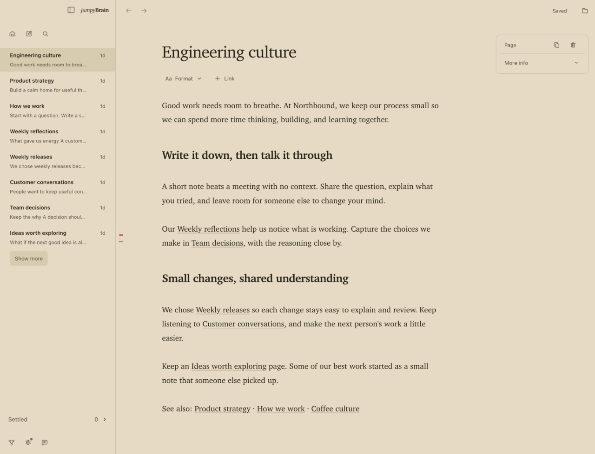
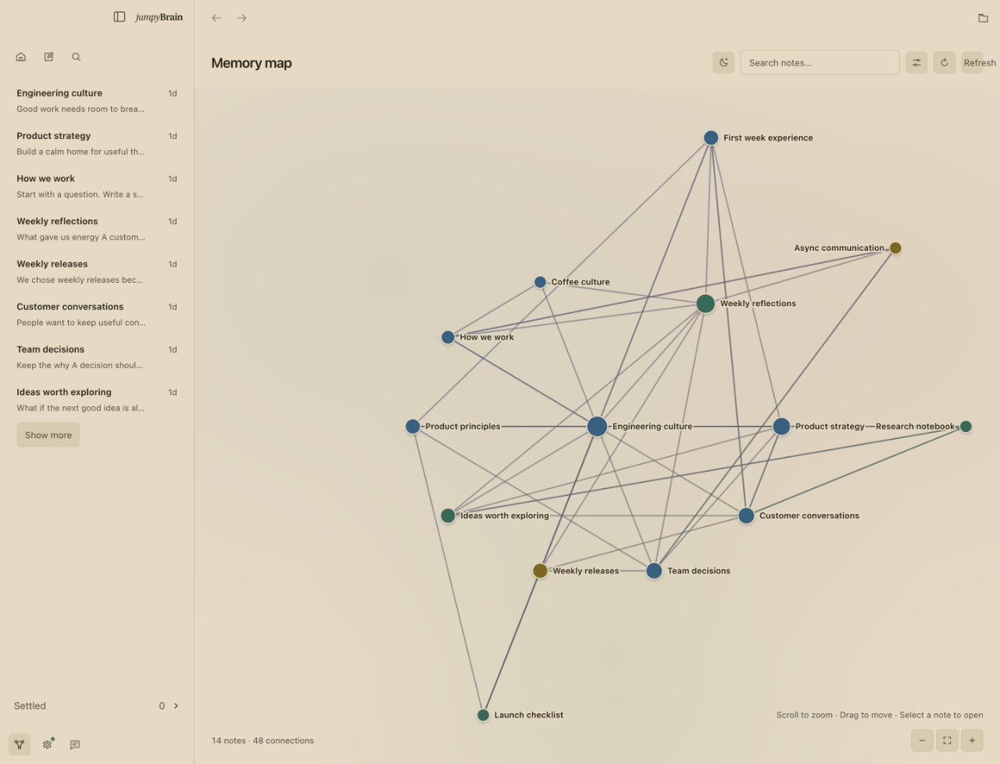

<p align="center">
  
</p>

<h1 align="center">Good thoughts deserve a home.</h1>

<p align="center">
  <strong>The open-source, agent-first Notion.</strong><br />
  A calm place for your notes, your team, and your AI agents to think together.
</p>

Install on macOS or Linux:

```sh
curl -fsSL https://raw.githubusercontent.com/nikoatwork/jumpyBrain/master/install.sh | bash
```

This sets up the CLI, local text search, and integrations for detected agents. Want the Mac app too? Add `-s -- --with-app` after `bash`. [Installation guide →](docs/install.md)

<p align="center">
  <strong><a href="https://demojumpybrain.juttu.co/">Explore the demo</a></strong>
  · <a href="#start-your-own-brain">Get started</a>
  · <a href="docs/cloud-shared-memory.md">Bring your team</a><br />
  MIT licensed · Markdown you own · Local and self-hosted · Beta
</p>

## Stop explaining everything again

You work something out with an agent. Make a decision with your team. Finally find the answer. Then a new chat starts—and you're back to explaining the whole thing.

jumpyBrain gives those thoughts a home. Keep your notes, decisions, and research in one place. Your agents can find them when you need them, even after you switch tools or start a fresh session.

Start with one project or a handful of notes. You don't have to move your whole life into it.

## A place you'll want to write

Open a page and start thinking. Your words save automatically to Markdown. Link ideas with `[[page references]]`, add a checklist, or keep it to a few sentences.

<p align="center">
  <a href="docs/assets/jumpybrain-writing.webp">
    
  </a>
</p>

Your agent works with the same notes. Ask it to capture a decision, find an old explanation, or help make sense of scattered research. You can edit together and see saved changes in the editor.

The app is your writing window. The CLI is how your agents use that same folder. **One brain, one set of notes.**

## Pick up where you left off

Use Claude Code today, Codex tomorrow, or Pi on another project. They can all work with the same brain. Other agents can join through the CLI.

Try asking:

> Remember that we chose weekly releases because smaller changes are easier to review.

In a fresh session:

> What did we decide about releases, and why?

Your agent searches for relevant notes instead of loading everything into every chat. Results point back to source files and lines, so you can check the reasoning.

Text search works from the start. Add a local embedding model when you want to search by meaning, too. Agents can ask for a short overview or open more evidence when a question needs it. [See the agent workflows →](docs/agent-workflows.md)

## Find the thread between ideas

A decision connects to some research. A meeting sparks an idea. A week later, that idea turns into a plan.

The memory map lets you follow those links and rediscover notes you'd forgotten to look for.

<p align="center">
  <a href="https://demojumpybrain.juttu.co/graph">
    
  </a>
</p>

*Screenshots use fictional notes. [Explore the public demo →](https://demojumpybrain.juttu.co/)*

For a growing collection, the optional [how-to-dream skill](skills/how-to-dream/SKILL.md) helps an agent turn scattered notes into topic pages, with links back to the evidence.

## Your brain. Or your team's.

**Just you?** Keep your brain in a folder on your computer. No jumpyBrain account, subscription, or remote server required. Open the Markdown in another editor whenever you like.

**Working with a team?** Self-host a shared brain. People and agents can write together, and a decision saved by one teammate becomes something another teammate's agent can find.

Keep personal notes local and team notes on your server. The Mac app lets you switch between named brains; connecting to a shared one doesn't sync or merge your personal folder. [Set up a shared brain →](docs/cloud-shared-memory.md)

## Your notes stay yours

Your brain is readable Markdown. Back it up, move it, put it in Git, or take it somewhere else. Search indexes can be rebuilt from your files.

jumpyBrain is [MIT licensed](LICENSE). Change it, build an integration, or make the workspace yours with [optional themes and tools](docs/extensions.md).

Local notes and search stay on your computer. Installing jumpyBrain doesn't upload your brain. If you give notes to a cloud assistant, send feedback, or choose a cloud-synced folder, those are separate sharing choices. [Privacy FAQ →](docs/faq.md#when-can-data-leave-my-computer)

## Start your own brain

Run the command at the top, or ask your agent to handle setup:

> Install jumpyBrain: https://github.com/nikoatwork/jumpyBrain. Follow docs/install-for-agents.md, reuse my existing brain, and verify local search. On a Mac, include the app and connect it to the same brain.

Restart an assistant that was already open so it can load its integration. Then ask it to remember one real decision and recall it in a fresh session. Setup itself doesn't save sample notes.

For the **Mac app + agents**, the full command is:

```sh
curl -fsSL https://raw.githubusercontent.com/nikoatwork/jumpyBrain/master/install.sh | bash -s -- --with-app
```

The Mac beta needs macOS 13+, Python 3.9+, and Xcode command-line tools. It still builds its native helper locally; signed, compiler-free app downloads are future work. The installer supplies private Node/npm when needed. [Mac app guide →](integrations/electron/README.md)

Already installed? Use the [update guide](docs/install.md#update). Beta updates can change how the app, CLI, server, and integrations work together; update them together and keep a backup.

Prefer to look around first? The [public demo](https://demojumpybrain.juttu.co/) uses a fictional team's notes. It's public, writable, and resets hourly—use fictional information only.

## Go deeper

- [Installation and updates](docs/install.md) · [Agent setup](docs/install-for-agents.md) · [FAQ](docs/faq.md)
- [Shared brains](docs/cloud-shared-memory.md) · [Live collaboration and recovery](docs/collaboration.md)
- [Import from Obsidian](docs/obsidian-migration.md) · [Import from Logseq](docs/logseq-migration.md)
- [CLI reference](docs/cli-commands.md) · [Technical design](docs/technical.md) · [Product vision](docs/product-vision.md)
- [Developer testing](docs/testing.md)
