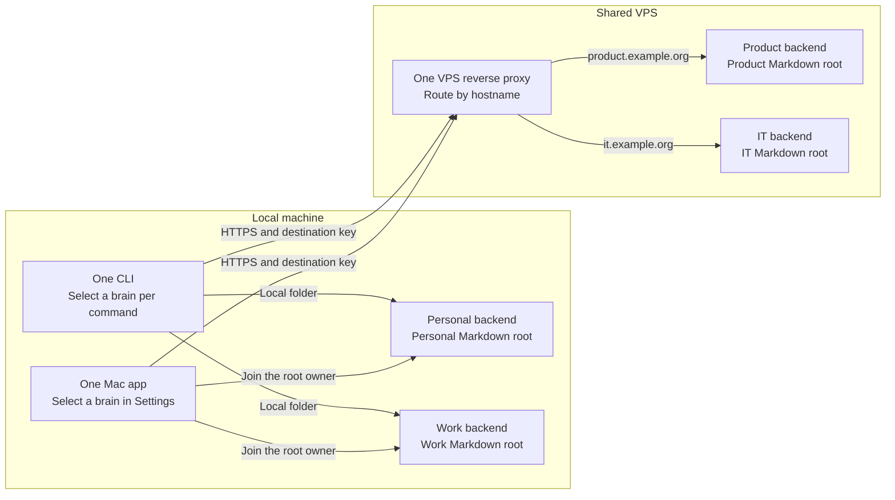

# Use several local and hosted brains

## Goal

Use one jumpyBrain CLI and one Mac app to reach several independent brains. Make a second hosted brain easy to add on the same VPS while existing local installs and hosted brains keep working through their current entry points.

## Target architecture

Each backend runs the same memory engine, with one authenticated owner per canonical root. Each brain has its own Markdown, derived index, and collaboration state. Hosted keys, browser sessions, invites, and backups are scoped to the brain. Clients share the destination model of a local folder or a remote origin, while the Mac app keeps its own active selection and save barrier.

Start with one process per brain. The existing server serves one root per process, and the app already supports multiple connections. Hostname routing preserves the existing HTTP and WebSocket paths and app origin format. Reconsider serving multiple roots in one process only if measured deployment or resource costs warrant it.

## Scope and sequencing

This can ship in slices. The hosted recipe is primarily deployment and documentation work. Named CLI targets are a bounded change with a security-sensitive credential boundary. Packaged upgrade and mixed Mac app verification carry most of the compatibility work. Make each slice usable on its own.

- **Existing evidence.** The November 26 review ran two local root owners and two hosted-style `serve` processes on loopback. Each pair rejected the other brain’s key, and stopping one left the other reachable. All 84 focused target, backend and gateway tests passed. The hosted slice later verified real proxy routing and measured a small lexical workload. Packaged upgrades remain open. [Feedback](../feedback.md) · [Root owners](../../src/app/backend-host/backend-host.docs.md) · [Companion gateway](../../integrations/macos-companion/gateway.docs.md)
- **Earlier decisions.** Keep app selection independent of CLI defaults. Keep local folder and direct URL selectors available. Use the existing target and credential resolution seams. Review the existing remote credential precedence before introducing named targets. [Targeting decision](../done/2026-11-02_tasks-brain-connections-and-targeting.md) · [Credential contract](../../src/adapters/credentials/credentials.docs.md)

## Upgrade path

| Existing setup | Adoption | Recovery |
| --- | --- | --- |
| Managed local CLI, with or without the Mac app | Update normally. Keep the configured folder, trusted project rules, saved connections, profile IDs and active app selection. Add a folder or CLI alias explicitly when needed. Existing notes, install mode and scripts stay in place. | Keep using the existing default or explicit flags. Verify the supported software rollback preserves the root and existing settings. Any new alias config must be optional and have a tested downgrade path. |
| Remote-only CLI or an older CLI / app connected to a hosted brain | Keep the original hostname, key, network paths and server protocol. Upgrade clients independently. Register a second origin as an additional connection. | Use the original URL and client configuration. Verify old clients still read, expand and, where permitted, write through the original origin. |
| One hosted brain on a VPS | Leave its service, canonical mount, public origin and credentials in place. Add the second service with a separate root, bootstrap key, private listener and proxy hostname. Check HTTPS, WebSockets and access before sharing it. | Remove the new route or stop the new service and keep its root for recovery. Verify the original brain stays reachable throughout the add and rollback. |
| Operator wants the original brain managed by the new deployment recipe | Adopt the same root and public origin in place. Preflight a private backup, compatible builds, permissions and configuration. Drain writes and live edits, stop the old owner, then start the replacement. Verify notes, links, keys, browser sessions and indexing before reopening writes. Allow a brief maintenance window for this optional handoff. | Before reopening writes, revert the service and proxy configuration against the current compatible root. Once new writes or revocations exist, verify data and version compatibility before rollback and preserve the current state. Rehearse recovery from the verified backup separately. |

Use the existing [managed install and rollback guide](../../docs/install.md), [hosted writer drain and backups](../../docs/cloud-shared-memory.md#drain-writers-before-migration-or-replacement), and [VPS upgrade procedure](../../docs/vps-deploy.md#9-backups-and-upgrades).

## Independent task lists

- [Hosted deployment](../done/2026-11-26_tasks-multi-brain-hosting.md) passed its gate for current clients using explicit URLs.
- [Named CLI targets](../done/2026-11-26_tasks-multi-brain-cli-targets.md) adds explicit aliases and verifies both transports with disposable roots and servers.
- [Upgrade and mixed Mac app connections](tasks-multi-brain-upgrade.md) verifies the two delivered slices together and rehearses adoption and rollback.

## Done when

The hosted and CLI lists have each passed their own gate, and the upgrade list records the end-to-end evidence. Keep this overview active until all three are complete.
